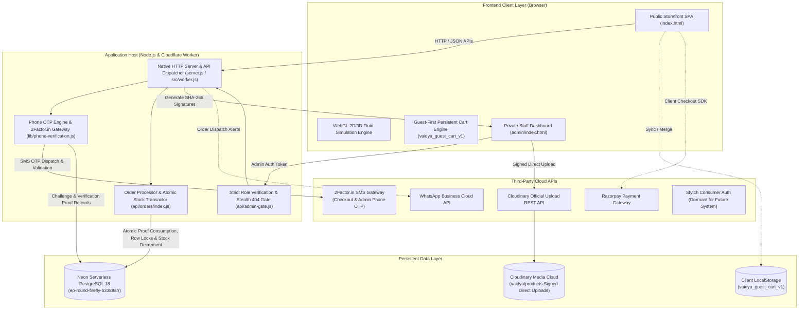
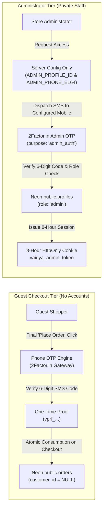
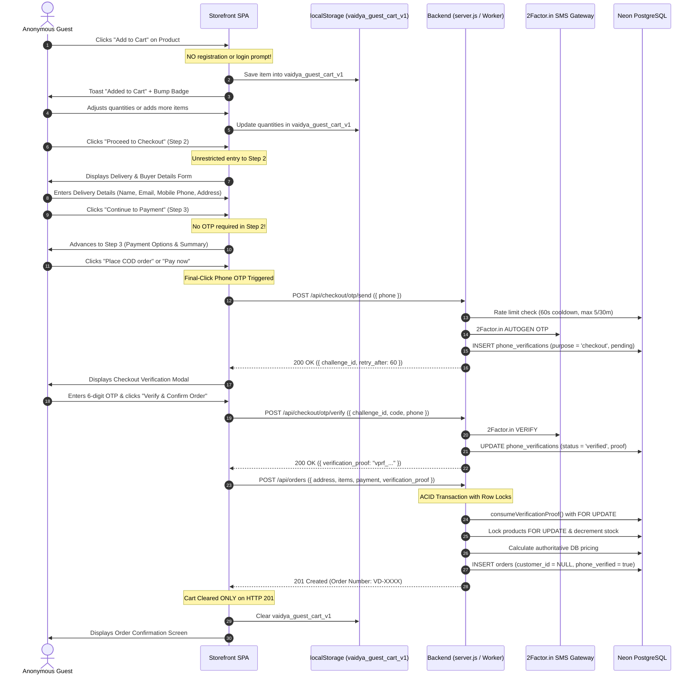
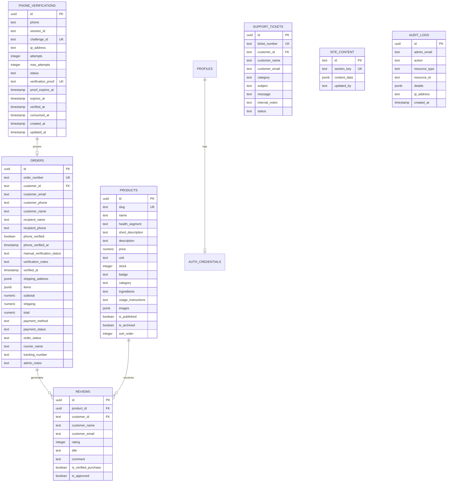

# Vaidya Botanicals: Complete System Architecture & Structure Blueprint

This document details the architectural layout, frontend client runtime, dual-tier authentication model, backend API dispatch system, database schemas, and end-to-end data lifecycle for the **Vaidya Botanicals** ecommerce application.

> **Living Document Notice:** Whenever substantial architectural, schema, or functional updates are made to the codebase, this blueprint is updated to reflect the authoritative state of the application.

---

## 1. High-Level Architecture Overview



---

## 2. Repository & Workspace Tree Map

```
c:\Users\Pratham Vatsa\Desktop\Py\
│
├── VAIDYA_BOTANICALS_ARCHITECTURE_BLUEPRINT.md # Living system architecture & structure blueprint
├── index.html                       # Public storefront single-page application & WebGL canvas
├── private-login.html               # Dedicated entrance for staff & administrators
├── server.js                        # Native Node.js HTTP server, router & static file streamer
├── package.json                     # Project manifest, NPM scripts & production dependencies
├── package-lock.json                # Deterministic dependency tree lockfile
├── wrangler.jsonc                   # Cloudflare Workers, Static Assets, Hyperdrive & R2 configuration
├── vercel.json                      # Serverless routing rules & headers configuration
├── .env.example                     # Environment variables template (No secrets)
├── .env.local                       # Local active environment variables (Ignored by Git)
├── .gitignore                       # Git exclusions (.env*, node_modules, uploads, logs)
│
├── public/                          # Synchronized Static Assets for Cloudflare Workers
│   ├── index.html                   # Storefront SPA mirror for edge distribution
│   ├── private-login.html           # Private login entrance mirror
│   └── admin/                       # Protected admin SPA directory
│       └── index.html               # Admin Dashboard mirror (Gated by Worker)
│
├── admin/                           # Private Staff Portal (Local Node.js source)
│   └── index.html                   # Admin Single-Page Application (Products, Orders, CMS, Reviews, Support)
│
├── src/                             # Cloudflare Workers Application Runtime
│   └── worker.js                    # Edge Worker entrypoint, stealth admin gate, API router & R2 adapter
│
├── api/                             # Backend API Endpoints (Micro-handlers)
│   ├── admin-gate.js                # Middle-layer security barrier for private endpoints
│   │
│   ├── admin/                       # Administrator-Only Management APIs (Strict verifyAdmin)
│   │   ├── content.js               # CMS homepage content & FAQ updates (GET, PUT)
│   │   ├── orders.js                # Order lifecycle, manual call verification & dispatch (GET, PUT)
│   │   ├── products.js              # Product catalogue CRUD, duplication & inventory (GET, POST, PUT, DELETE)
│   │   ├── reviews.js               # Customer review moderation queue & approvals (GET, PUT, DELETE)
│   │   ├── support.js               # Customer support ticket resolution & private notes (GET, PUT)
│   │   └── upload.js                # Multipart product image & attachment ingestion (POST)
│   │
│   ├── auth/                        # Authentication & Session Handlers
│   │   ├── admin-login.js           # Admin login via PBKDF2/SHA-512 verification (POST)
│   │   ├── admin-logout.js          # Admin cookie invalidation (POST)
│   │   ├── admin-session.js         # Admin JWT session validation (GET)
│   │   ├── customer-login.js        # Dormant legacy customer login fallback (POST)
│   │   ├── customer-logout.js       # Dormant customer session revocation (POST)
│   │   ├── customer-register.js     # Dormant legacy registration fallback (POST)
│   │   ├── customer-reset.js        # Dormant customer password reset handler (POST)
│   │   ├── customer-session.js      # Dormant customer session validation (GET)
│   │   ├── customer-verify.js       # Dormant email verification token check (GET)
│   │   ├── otp-send.js              # Dormant Stytch Passwordless Email OTP dispatch (POST)
│   │   └── otp-verify.js            # Dormant Stytch OTP verification & Neon profile sync (POST)
│   │
│   ├── cart/                        # Shopping Cart Management APIs (Dormant Customer Sync)
│   │   ├── index.js                 # Customer cart retrieval and persistence (GET, PUT)
│   │   └── merge.js                 # Transactional guest cart merge & inventory clamping (POST)
│   │
│   ├── checkout/                    # Guest Checkout & Phone OTP Verification
│   │   └── otp/
│   │       ├── send.js              # Dispatches SMS OTP to buyer's mobile (POST)
│   │       └── verify.js            # Verifies OTP and issues checkout proof (POST)
│   │
│   ├── content/                     # Public Content Delivery API
│   │   └── index.js                 # Public homepage marketing copy & FAQs (GET)
│   │
│   ├── orders/                      # Customer Order Placement API
│   │   └── index.js                 # Guest order creation with OTP proof consumption & atomic stock decrement (GET, POST)
│   │
│   ├── products/                    # Public Product Catalogue API
│   │   └── index.js                 # Published products listing & detail retrieval (GET)
│   │
│   ├── razorpay/                    # Online Payment Gateway Handlers
│   │   ├── create-order.js          # Razorpay order generation (POST)
│   │   └── verify-payment.js        # HMAC-SHA256 signature verification (POST)
│   │
│   ├── reviews/                     # Public Reviews API
│   │   └── index.js                 # Verified purchase review feed & customer submissions (GET, POST)
│   │
│   └── support/                     # Customer Helpdesk API
│       └── index.js                 # Public support ticket submission & reference lookup (GET, POST)
│
├── database/                        # Database Infrastructure & Tooling
│   ├── create_runtime_role.sql      # Least-privilege DML role (vaidya_runtime) for Cloudflare Workers
│   ├── migrate.js                   # Direct unpooled DDL migration executor
│   ├── schema.sql                   # Authoritative DDL schema for Neon PostgreSQL 18
│   ├── seed.sql                     # Idempotent seed data (Initial catalog, CMS content)
│   └── verify.js                    # Database integrity and connectivity validation script
│
├── lib/                             # Core Application Modules & Shared Utilities
│   ├── auth.js                      # Admin JWT & customer session management, PBKDF2 hashing, subtle crypto
│   ├── cart.js                      # Cart validation, live pricing, stock clamping & Neon merge
│   ├── db.js                        # Neon PostgreSQL connection pool & Cloudflare Hyperdrive client runner
│   ├── phone-verification.js        # Phone normalization, 2Factor.in SMS integration, rate limiting & proof issuance
│   ├── razorpay.js                  # Razorpay SDK configuration & signature validator
│   ├── stytch.js                    # Stytch B2C Consumer Auth client & session management (Dormant)
│   ├── supabase.js                  # Legacy migration bridge & in-memory test fallback
│   └── whatsapp.js                  # WhatsApp Cloud API notifications helper
│
├── scripts/                         # Administrative Automation Scripts
│   ├── bootstrap-admin.js           # CLI tool to create/promote master administrator
│   └── sync-assets.js               # Synchronizes storefront & admin SPAs to ./public for Workers
│
├── test/                            # Comprehensive Automated Test Suites
│   ├── cloudflare-worker.test.js    # Cloudflare Workers stealth gate, API routing, R2 & subtle crypto tests
│   ├── db.test.js                   # Neon PostgreSQL connection, transaction & rollback tests
│   ├── guest-checkout.test.js       # Complete 21-scenario guest checkout & phone OTP verification test suite
│   ├── milestone1.test.js           # Storefront, admin gate, login & session tests
│   ├── milestone2.test.js           # Product catalogue, CRUD, image upload & archive tests
│   ├── milestone3.test.js           # CMS content management & FAQ live synchronization tests
│   ├── milestone4.test.js           # Order placement, status updates, reviews & support tests
│   ├── phase2-neon-orders.test.js   # Live Neon order transactions, isolation & stock locking tests
│   ├── security.test.js             # Threat modeling, forgery, role-elevation & payload tests
│   └── stytch-cart.test.js          # Stytch OTP, guest cart persistence, continuous checkout tests
│
└── uploads/                         # Local development image storage directory (Mirrors Cloudflare R2)
```

---

## 3. Frontend Architecture

### 3.1 Architecture Overview
The user interface is structured as two Single-Page Applications (SPAs) built with modern standards, without heavy build-step frameworks (no React or Vue overhead).
- **Public Storefront ([`index.html`](file:///c:/Users/Pratham%20Vatsa/Desktop/Py/index.html)):** Customer-facing catalog, interactive WebGL canvas, guest cart, passwordless checkout modal, customer order review, and support desk.
- **Admin Management Portal ([`admin/index.html`](file:///c:/Users/Pratham%20Vatsa/Desktop/Py/admin/index.html)):** Private back-office dashboard for inventory, orders, call verification, CMS, and reviews.

### 3.2 Styling, Typography & Design Tokens
- **Framework:** Tailwind CSS (loaded via CDN) enhanced with bespoke CSS utility classes.
- **Typography:**
  - *Playfair Display* (Serif): Used for luxury editorial headings, segment labels, and product titles.
  - *Plus Jakarta Sans* (Sans-serif): Used for clean, legible body text, price badges, and inputs.
- **Color Palette:**
  - `vaidya-bg`: Deep obsidian `#121212` / `#16181D`.
  - `vaidya-card`: Rich dark card `#1E2026`.
  - `vaidya-accent`: Ayurvedic emerald `#20E070`.
  - `vaidya-accentMuted`: Translucent emerald `rgba(32, 224, 112, 0.25)`.
  - `vaidya-textPrimary`: High-contrast slate `#E2E8F0`.
  - `vaidya-textSecondary`: Muted slate `#94A3B8`.

### 3.3 Interactive WebGL Fluid Splash Cursor Engine
Located directly in [`index.html`](file:///c:/Users/Pratham%20Vatsa/Desktop/Py/index.html#L1100-L1972):
- **Simulation Pipeline:** Navier-Stokes fluid dynamics evaluated on the GPU using WebGL shaders.
- **Shaders Implemented:**
  - `splat`: Injects velocity and dye impulses upon mouse move or touch drags.
  - `curl` & `vorticity`: Generates swirling turbulence and lifelike liquid micro-eddies.
  - `divergence` & `pressure`: Solves Poisson pressure equations iteratively to maintain incompressible flow.
  - `advection`: Moves dye and momentum across the velocity vector field.
  - `bloom`: Multi-pass downsampled Gaussian blur pipeline producing an ethereal organic glow.
- **DOM Integration:** Fixed fullscreen `<canvas id="splash-cursor__canvas">` with `pointer-events: none` and `z-index: 1`, allowing seamless click-through to buttons, links, and cards.

### 3.4 Storefront Navigation & View Routing
Client-side routing uses URL hash fragments (`window.location.hash`), monitored via the `hashchange` event:
- `#` (Empty / Home): Hero banner, philosophy, segment showcase, and benefits.
- `#discover`: Full searchable botanical offering grid with category filters (`All`, `Teas`, `Oils`).
- `#story`: Dedicated Ayurvedic heritage narrative and distillation ritual showcase.
- `#support`: Interactive helpdesk with ticket creation form and instant status lookup.
- `#cart`: Multi-step checkout pipeline (Step 1: Review, Step 2: Delivery, Step 3: Payment).

---

## 4. Authentication & Phone Verification Architecture

Vaidya Botanicals strictly enforces a **Guest-First, No Customer Accounts** model on the storefront, coupled with an isolated **Passwordless Administrator Phone OTP Tier**:



### 4.1 Guest Checkout & Final-Click Phone OTP Verification (2Factor.in)
1. **Unrestricted Shopping:** No login or registration prompts. Shoppers browse, add to cart, and adjust items with zero friction.
2. **Buyer Verification Requirement:** Email is collected for order receipts without requiring login. Mobile phone number is verified via OTP SMS using Indian SMS gateway 2Factor.in.
3. **Final-Click Verification Trigger:** Phone OTP is triggered exclusively when the customer clicks the final "Place Order" button in checkout (Step 3).
4. **Challenge Lifecycle:**
   - Client calls `POST /api/checkout/otp/send` with `{ phone }`.
   - Backend normalizes to 10-digit Indian mobile format (`^[6-9]\d{9}$`).
   - Rate limit enforcement: 60-second cooldown per phone; max 5 requests per phone per 30 minutes; max 15 requests per IP per 30 minutes. Scoped to `purpose = 'checkout'`.
   - 2Factor.in sends OTP via AUTOGEN endpoint; backend records `challenge_id` in `public.phone_verifications`.
5. **Verification & Proof Issuance:**
   - Buyer inputs code to `POST /api/checkout/otp/verify` with `{ challenge_id, code, phone }`.
   - Backend verifies code, enforces `purpose = 'checkout'`, increments attempt counters, and verifies expiration.
   - On match, backend issues a cryptographically secure, one-time verification proof token (`vprf_<hex>`, 15-minute validity).
6. **Atomic Order Consumption:**
   - Client sends `{ address, items, payment, verification_proof }` to `POST /api/orders`.
   - Inside an ACID transaction with row-level locking (`SELECT ... FOR UPDATE`), the backend invokes `consumeVerificationProof()`.
   - Verifies proof is valid, unexpired, and matches the buyer's phone number. Marks status as `consumed`.
   - Stores order with `customer_id = NULL`, `phone_verified = true`, `phone_verified_at = verified_at`.
   - Consumed proof cannot be replayed or reused for subsequent orders. Cart is cleared only upon confirmed HTTP 201.
7. **Dormant Customer Account Subsystem:**
   - Stytch authentication and customer profile tables (`profiles`, `customer_carts`, `customer_sessions`) remain preserved and dormant in the codebase and schema for any future account requirements.

### 4.2 Administrator Authentication (Passwordless Phone OTP & 8-Hour Session)
1. **PBKDF2 Removal on Edge:** PBKDF2-SHA512 100,000-iteration hashing (80+ ms CPU) is completely removed from the Cloudflare Worker edge route table to stay strictly within the 10 ms CPU allowance of the Cloudflare Free Plan.
2. **Single Preconfigured Identity:** Authorizes exclusively one preconfigured administrator identity:
   - `ADMIN_PROFILE_ID` (identifies administrator record in Neon `public.profiles` where `role = 'admin'`).
   - `ADMIN_PHONE_E164` (authorized mobile number, never trusted from client input).
3. **Dedicated Endpoints:**
   - `POST /api/auth/admin-otp/send`: Reads phone from server config, applies 60s cooldown and velocity limits, stores challenge with `purpose = 'admin_auth'`, and dispatches OTP via 2Factor.in.
   - `POST /api/auth/admin-otp/verify`: Verifies code, rejects expired/reused challenges, confirms Neon profile still has `role = 'admin'`, and issues a signed session cookie.
4. **Strict Cross-Purpose Isolation:**
   - Checkout OTPs are rejected if submitted to `/api/auth/admin-otp/verify`.
   - Administrator OTPs are rejected if submitted to `/api/checkout/otp/verify`.
5. **Session Security:**
   - Signs HS256 JWT with `ADMIN_JWT_SECRET`.
   - Issues `vaidya_admin_token` cookie with an 8-hour lifetime (`maxAge: 28800`).
   - `HttpOnly: true`, `SameSite: Lax`, `Secure: true` in production.
   - `POST /api/auth/admin-logout` clears the session cookie immediately (`maxAge: 0`).
   - `verifyAdmin()` strictly verifies signature, expiry, and current role in Neon PostgreSQL.

---

## 5. End-to-End Shopping Journey & Cart Lifecycle


    UI->>Local: Clear vaidya_guest_cart_v1
    UI->>Guest: Displays Order Confirmation Screen
```

---

## 6. How and Where What Data Is Stored

### 6.1 Client-Side Browser Storage

| Key / Cookie Name | Storage Medium | Structure / Format | Purpose |
| :--- | :--- | :--- | :--- |
| `vaidya_guest_cart_v1` | `localStorage` | JSON Array of `[{ id, name, price, unit, qty }]` | Stores anonymous guest items across browser reloads. Cleared ONLY upon HTTP 201 order confirmation. |
| `vaidya_address` | `localStorage` | JSON Object `{ customer_name, customer_email, customer_phone, is_gift, recipient_name, recipient_phone, l1, l2, city, state, pin, landmark }` | Remembers buyer delivery preferences for subsequent 1-click checkouts. |
| `vaidya_outbox` | `localStorage` | JSON Array | Client-side audit buffer for order events when offline or unhooked. |
| `vaidya_admin_token` | HTTP-Only Cookie | Signed JWT (`sub`, `email`, `role: 'admin'`) | Administrative staff authentication credential. |

---

### 6.2 Server-Side Persistent Storage (Neon PostgreSQL 18)

Database connection string targets the **Neon `development` branch** (`ep-round-firefly-b3388srr`).

#### Database Schema Overview



#### Detailed Table Specifications

1. **`public.profiles`**: Core identity table.
   - `id`: Unique text ID (e.g. `cust_...`).
   - `email`: Normalized lowercase unique customer or admin email.
   - `role`: Strict ENUM (`customer`, `admin`).
   - `stytch_user_id`: External unique Stytch B2C identifier.
2. **`public.auth_credentials`**: Dedicated credentials store for staff admins.
   - `password_hash`: Salted PBKDF2/SHA-512 string (`salt:hash`).
3. **`public.customer_carts`**: Server-persisted active customer shopping carts.
   - `items`: JSONB array of validated items with live prices and quantities.
   - Cleared automatically upon order completion.
4. **`public.products`**: Authoritative botanical catalog.
   - `slug`: Human-readable unique URL slug.
   - `price` & `stock`: Authoritative financial and inventory values.
   - `images`: JSONB array of Cloudflare R2 / local photo URLs with primary flags.
5. **`public.orders`**: Complete transactional order ledger.
   - `order_number`: Human-readable identifier (e.g. `VD-MVW446R5-0ELD`).
   - `customer_id`: NULL for guest checkout orders (no customer profile created).
   - `recipient_name` & `recipient_phone`: Distinct fields for gift orders.
   - `phone_verified`: True if buyer completed SMS OTP verification at checkout.
   - `phone_verified_at`: Timestamp of successful phone OTP verification.
   - `manual_verification_status`: Pre-dispatch manual call verification tracking (`unverified`, `call_attempted`, `verified`, `call_failed`).
   - `shipping_address` & `items`: Immutable JSONB snapshots frozen at purchase time.
6. **`public.phone_verifications`**: Ephemeral phone OTP challenge and verification proof store.
   - `challenge_id`: Safe challenge identifier returned to client (`ch_<hex>`).
   - `phone`: 10-digit normalized Indian mobile number.
   - `session_id`: 2Factor.in SMS gateway session identifier.
   - `verification_proof`: Single-use cryptographic proof token (`vprf_<hex>`, 15-minute validity).
   - `status`: State tracking (`pending`, `verified`, `consumed`, `expired`).
   - `attempts` & `max_attempts`: Velocity protection against brute-force guesses (max 3 attempts).
7. **`public.reviews`**: Moderated customer feedback.
   - `is_verified_purchase`: Automatically set to true if customer email matches a delivered order.
   - `is_approved`: Moderation gate controlled by admin.
8. **`public.support_tickets`**: Customer helpdesk records.
   - `internal_notes`: Private staff notes strictly scrubbed from public ticket lookup.
9. **`public.site_content`**: Dynamic CMS entries.
   - `section_key`: Unique keys (`hero`, `about`, `story`, `support_info`).
10. **`public.audit_logs`**: Tamper-evident admin action trail.
    - Records every change made in the admin portal with IP address and timestamps.

---

### 6.3 Media & Object Storage Layer (Cloudflare R2)

- **Public Bucket (`vaidya-public-assets`):** Stores optimized botanical photography, herbal infusion illustrations, and packaging graphics. Served via `https://assets.vaidyabotanicals.com` or local fallback route `/uploads/`.
- **Private Bucket (`vaidya-private-attachments`):** Stores customer support attachments, invoices, and audit exports. Access requires pre-signed URLs.

---

## 7. Backend API Endpoint Directory

```
API Routing Table
├── Public Guest Customer Endpoints
│   ├── GET  /api/products                   # Retrieve published botanical catalogue
│   ├── GET  /api/content                    # Retrieve CMS copy, statistics & FAQs
│   ├── POST /api/checkout/otp/send          # Send 4-6 digit SMS OTP to buyer mobile (Rate limited: 60s cooldown, max 5/30m)
│   ├── POST /api/checkout/otp/verify        # Verify OTP code and issue one-time verification proof (vprf_...)
│   ├── POST /api/orders                     # Place guest COD or prepaid order (requires valid verification_proof)
│   ├── GET  /api/reviews                    # Public feed of approved 5-star customer reviews
│   ├── POST /api/reviews                    # Submit review (placed in moderation queue)
│   ├── GET  /api/support                    # Check status of support ticket by ticket_number
│   ├── POST /api/support                    # Submit new support inquiry
│   └── POST /api/razorpay/verify-payment    # Cryptographic HMAC payment verification
│
├── Passwordless Customer Authentication (Stytch)
│   ├── POST /api/auth/otp-send              # Request 6-digit email passcode (Rate-limited)
│   ├── POST /api/auth/otp-verify            # Verify passcode & issue vaidya_customer_session
│   ├── GET  /api/auth/customer-session      # Check active customer session & email
│   └── POST /api/auth/customer-logout       # Revoke session in Stytch & clear session cookie
│
├── Persistent Shopping Cart
│   ├── GET  /api/cart                       # Fetch customer's active Neon cart
│   ├── PUT  /api/cart                       # Update customer's active Neon cart
│   └── POST /api/cart/merge                 # Merge guest items with stock clamping & live pricing
│
├── Orders & Checkout
│   ├── GET  /api/orders                     # Retrieve customer's isolated order history
│   └── POST /api/orders                     # Create order with row-locked stock decrement
│
└── Private Administrator Endpoints (Protected by verifyAdmin)
    ├── POST /api/auth/admin-login           # Staff login with PBKDF2/SHA-512 authentication
    ├── GET  /api/auth/admin-session         # Verify active admin JWT
    ├── POST /api/auth/admin-logout          # Revoke admin cookie
    ├── GET  /api/admin/products             # Retrieve full catalog including drafts & archived
    ├── POST /api/admin/products             # Create new product
    ├── PUT  /api/admin/products             # Update product price, stock, or metadata
    ├── DEL  /api/admin/products             # Archive/delete product
    ├── GET  /api/admin/orders               # Search, filter, and inspect customer orders
    ├── PUT  /api/admin/orders               # Update tracking, delivery status & call verification
    ├── GET  /api/admin/content              # Retrieve raw CMS entries
    ├── PUT  /api/admin/content              # Update hero, philosophy, and FAQ text
    ├── GET  /api/admin/reviews              # Moderate pending customer reviews
    ├── PUT  /api/admin/reviews              # Approve/reject customer review
    └── POST /api/admin/upload               # Secure multipart image upload pipeline
```

---

## 8. Summary of Architectural Principles

1. **Guest-First Commerce:** Shopping and cart building are completely friction-free. Authentication is requested only when necessary to confirm customer identity and delivery details.
2. **Passwordless Simplicity:** Passwords are completely eliminated for customers. Authentication is handled seamlessly by Stytch Email OTP.
3. **Continuous Resumption:** The checkout pipeline never redirects customers back to the home page or causes them to lose their cart.
4. **Strong Data Integrity:** All financial figures and inventory deductions are computed server-side in Neon PostgreSQL transactions using row-level locking (`FOR UPDATE`).
5. **Strict Admin Stealth & Isolation:** The management tier is completely isolated from customer endpoints, returning 404s to unauthorized callers to conceal administrative surfaces.

---

## 9. Edge Architecture: Cloudflare Workers, Static Assets, Hyperdrive & R2

```mermaid
flowchart TD
    Visitor["Web Client / Browser"]
    
    subgraph CloudflareEdge["Cloudflare Global Network (Edge)"]
        CFRouter{"Edge URL Router\n(run_worker_first)"}
        StaticAssets["Cloudflare Static Assets CDN\n(directory: ./public)"]
        EdgeWorker["Cloudflare Worker Entrypoint\n(src/worker.js)"]
        
        AdminGate{"Admin Stealth Gate\n(verifyAdmin)"}
        ApiDispatcher{"API Router\n(27 API Handlers)"}
    end
    
    subgraph StorageAndCompute["Infrastructure Services"]
        Hyperdrive["Cloudflare Hyperdrive\n(Edge Connection Pool)"]
        NeonDB[("Neon PostgreSQL 18\n(Development Branch)")]
        R2Buckets[("Cloudflare R2 Object Storage\n(vaidya-public-assets)")]
        StytchAPI["Stytch Consumer Auth API"]
    end

    Visitor -->|HTTP Request| CFRouter
    
    %% Free, unlimited static path
    CFRouter -->|"Storefront Assets: /, /index.html,\n/private-login.html, images, CSS, JS"| StaticAssets
    StaticAssets -->|200 Static Content\n(Zero Worker Invocations)| Visitor
    
    %% Selective Worker paths
    CFRouter -->|"Selective: /api/*"| EdgeWorker
    CFRouter -->|"Selective: /admin, /admin/*,\n/admin/index.html"| EdgeWorker
    
    EdgeWorker --> AdminGate
    EdgeWorker --> ApiDispatcher
    
    AdminGate -->|"Unauthorized (No Cookie / Non-Admin)"| Stealth404["HTTP 404 'Not Found'"]
    Stealth404 --> Visitor
    AdminGate -->|"Authorized (valid vaidya_admin_token)"| ServeAdmin["env.ASSETS.fetch('/admin/index.html')"]
    ServeAdmin --> StaticAssets
    
    ApiDispatcher -->|"Database Queries via lib/db.js"| Hyperdrive
    Hyperdrive -->|"Direct Unpooled Connection\n(vaidya_runtime role)"| NeonDB
    ApiDispatcher -->|"Product Image Uploads"| R2Buckets
    ApiDispatcher -->|"Email OTP Dispatch & Verify"| StytchAPI
```

### 9.1 Selective Worker-First Routing & Quota Optimization
Rather than enabling `assets.run_worker_first = true` globally (which consumes Worker invocations for every CSS file, JS bundle, image, and page view), the deployment specifies targeted routing in [`wrangler.jsonc`](file:///c:/Users/Pratham%20Vatsa/Desktop/Py/wrangler.jsonc):
```jsonc
"assets": {
  "directory": "./public",
  "binding": "ASSETS",
  "html_handling": "auto-trailing-slash",
  "not_found_handling": "single-page-application",
  "run_worker_first": [
    "/api/*",
    "/admin",
    "/admin/*",
    "/admin/index.html"
  ]
}
```
- **Storefront Performance & Cost:** High-volume customer browsing on the storefront (`/`, `index.html`, `private-login.html`) bypasses the Worker entirely and is served directly by Cloudflare Static Assets for **free and unlimited bandwidth**.
- **Edge Worker Quota Preservation:** Only actual API calls (`/api/*`) and protected administrator management views consume Worker execution units, allowing the storefront to operate comfortably within the 100,000 requests/day Cloudflare Free plan tier.

### 9.2 Direct Administrator Stealth Gating
Cloudflare Static Assets does not have built-in cookie inspection. To ensure that an unauthenticated visitor cannot access the Admin Dashboard by requesting `/admin`, `/admin/`, or direct `/admin/index.html`:
1. Every admin route matches the `run_worker_first` array and hits `src/worker.js`.
2. The Worker extracts the `vaidya_admin_token` cookie and verifies the JWT and role via `verifyAdmin`.
3. If unauthorized, it immediately returns an HTTP 404 response (`404 Not Found`).
4. If authorized, it proxies the request to `env.ASSETS.fetch('/admin/index.html')`.
5. All `/api/admin/*` endpoints independently enforce `verifyAdmin` before processing any payload or returning sensitive business data.

### 9.3 Database Security: Least-Privilege Role & Hyperdrive Lifecycle
- **Runtime Role ([`database/create_runtime_role.sql`](file:///c:/Users/Pratham%20Vatsa/Desktop/Py/database/create_runtime_role.sql)):** The deployed Worker does not connect as `neondb_owner`. A dedicated role `vaidya_runtime` is granted only required DML permissions (`SELECT`, `INSERT`, `UPDATE`, `DELETE`) on application tables, and `USAGE, SELECT` on sequences. DDL permissions (`CREATE`, `DROP`, `ALTER`) are strictly withheld.
- **Connection Pattern in [`lib/db.js`](file:///c:/Users/Pratham%20Vatsa/Desktop/Py/lib/db.js):** Following Cloudflare's official Hyperdrive integration guideline, edge requests do not use a long-lived Node.js pool. Instead, each query/transaction instantiates a per-request `new Client({ connectionString: env.HYPERDRIVE.connectionString })`, executes the parameterized SQL, and guarantees socket termination via `await client.end().catch(() => {})` in a `finally` block.
- **Zero Secrets in Git:** Hyperdrive connection strings and Neon passwords are never committed to Git or hardcoded in configuration files. Schema migrations continue to use direct unpooled connections (`DATABASE_URL_UNPOOLED`) via `neondb_owner` from secured local environments.

### 9.4 Cloudflare R2 Persistent File Storage
In [`api/admin/upload.js`](file:///c:/Users/Pratham%20Vatsa/Desktop/Py/api/admin/upload.js):
- High-resolution product images and attachments are uploaded to Cloudflare R2 bucket bindings (`env.PUBLIC_ASSETS_BUCKET` and `env.PRIVATE_ASSETS_BUCKET`).
- The handler preserves size limits (5 MB maximum) and validates MIME types (`image/jpeg`, `image/png`, `image/webp`, `image/svg+xml`).
- Uploads are written via `await r2Bucket.put(storagePath, buffer, { httpMetadata: { contentType } })`.
- For local Node.js development (`server.js`), the handler automatically falls back to the local `uploads/` directory on disk.

### 9.5 PBKDF2/SHA-512 CPU Time Constraints & Plan Allocation
- **Cryptographic Security Preservation:** To preserve rigorous security standards, administrator password hashing retains 100,000 iterations of SHA-512. Security parameters are not reduced.
- **CPU Benchmark:** 100,000 iterations of SHA-512 benchmarked at **83.04 ms** CPU time.
- **Plan Requirement:** The Cloudflare Free plan enforces a strict 10 ms CPU execution limit per request. Therefore:
  - **Customer Authentication (Stytch OTP):** Consumes < 2 ms CPU time per request, completely safe on the Cloudflare Free Plan.
  - **Production Administrator Login:** Exceeds the 10 ms Free CPU threshold and requires the Cloudflare Workers Paid Plan ($5/month with 30-second CPU limit).
- **Subtle Crypto Compatibility:** [`lib/auth.js`](file:///c:/Users/Pratham%20Vatsa/Desktop/Py/lib/auth.js) exposes `verifyPasswordAsync`, which uses Web Crypto API (`crypto.subtle`) when running in Workers or modern Node.js runtimes, with constant-time XOR byte comparison.

### 9.6 Dual-Runtime Compatibility
The application codebase natively supports both environments:
1. **Local Development & Regression Testing:** `npm start` and `server.js` continue to run natively on Node.js using `pg.Pool`, local filesystem uploads (`uploads/`), and standard TCP sockets.
2. **Edge Deployment:** `npm run dev:wrangler` synchronizes static assets to `./public` via [`scripts/sync-assets.js`](file:///c:/Users/Pratham%20Vatsa/Desktop/Py/scripts/sync-assets.js) and boots `wrangler dev` targeting `src/worker.js`.


